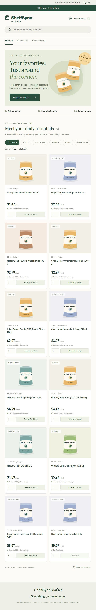
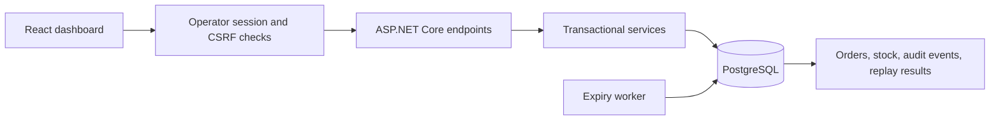

# ShelfSync

**Inventory reservations and order fulfillment with transactional stock protection.**

ShelfSync models one fictional store where online reservations and point-of-sale sales share shelf inventory. The application prevents software operations from claiming the same available units, handles reservation expiry, and records stock movements in an audit ledger.

Built with **ASP.NET Core 10 · PostgreSQL 18 · Npgsql · React · TypeScript · Vite**.



## What works

- Click-through associate item pages with barcode, shelf location, stock buckets, sales history and inventory activity (requires the product-profile migration).
- Reservations with a 15-minute lifetime and safe idempotent retries.
- Operator shelf/bin location editing and audited shelf-count corrections with stale-count and reservation safeguards.
- Orders screen with search, state filters, cancellation, picking, shortage reporting/resolution and fulfillment.
- POS sales with event-based deduplication and stock validation.
- Row locks and atomic database transactions for inventory mutations and audit events.
- Background expiry processing and explicit lifecycle rules.
- Operator sign-in, protected API access, CSRF protection, login throttling and credential-change session invalidation.
- A combined dashboard/API release package, local startup scripts and CI configuration.

## Run locally

Requirements: **PowerShell 7, .NET 10 SDK, Node.js 24, PostgreSQL 18**.

First configure a development database and its connection as described in [setup](docs/setup.md). On the original development machine the database connection is already configured.

From the repository root:

```powershell
pwsh -File scripts/Set-Operator.ps1
pwsh -File scripts/Start-Local.ps1 -Build
```

Choose your operator password when prompted, then open **http://localhost:5000**. Default username: `operator`. Later starts need only `pwsh -File scripts/Start-Local.ps1`. The backend serves the compiled dashboard; no separate frontend server is needed.

For frontend development, run the backend on localhost:5000 and `npm ci` followed by `npm run dev` inside `frontend/`. Open localhost:5173; Vite proxies the API.

## Verify the release

```powershell
pwsh -File scripts/Verify-Release.ps1
```

This builds the release and runs the suite against a separate temporary, password-protected PostgreSQL instance. It does not modify the existing PostgreSQL service, databases or permissions. The temporary instance stops afterward; ignored diagnostic files remain under `artifacts/`.

**Verified 23 October 2026:** 53 integration tests passed (including associate details and operator maintenance), zero failures/skips; published reservation/order/POS workflows, stock invariants, security checks, production HTTP rejection, frontend build and lint passed. A release also built from a clean committed-source snapshot. Remote CI and Docker execution were not run locally.

## Engineering highlights



Reservations and POS sales serialize competing inventory changes using product inventory row locks. Successful stock/order/audit/replay writes commit together. A retried reservation uses the same operation key; a retried sale uses the same event ID. Reusing an identifier for a different payload is rejected.

Shelf units and picked units are separate stock stages. Reservations hold shelf availability logically; picking physically moves the recorded quantity from shelf to picked; fulfillment consumes picked stock. The backend remains authoritative even if the dashboard is stale.

## Package

```powershell
pwsh -File scripts/Publish.ps1 -Archive
```

Produces `artifacts/publish/`, `artifacts/publish.zip` and its SHA-256 checksum. The package includes build metadata, compiled API and dashboard. Configure database/operator secrets separately on the destination machine.

## Explore

| Document | Contents |
| --- | --- |
| [Setup](docs/setup.md) | Prerequisites, database roles, configuration and startup |
| [Architecture](docs/architecture.md) | Actual file map, request flow, stock rules and tradeoffs |
| [Associate item details](docs/associate-details.md) | Metadata migration, stock definitions and sales history |
| [API](docs/api-contract.md) | Implemented routes, authentication, payloads and errors |
| [Release guide](docs/local-release.md) | Verification evidence, packaging and operational limits |
| [Demo and portfolio notes](docs/portfolio.md) | Walkthrough, interview talking points and project description |
| [Acceptance checklist](docs/acceptance-scenarios.md) | Current release criteria and future extensions |

## Scope and limits

This is a **local single-operator portfolio MVP**, using fictional products. Public hosting and customer accounts are outside the selected release scope. Production API access requires HTTPS; trusted proxy and key persistence configuration must be validated on a real hosting platform.

POS sales are conservatively rejected when they would consume reserved stock; the app does not model external checkout discrepancies or negative stock. Picked-order cancellation/restocking, receiving/reconciliation UI and stale-feed gating remain future extensions. Inventory counts shown in the UI are physical counts, not computed sellable availability. The latest 100 orders are shown. Uncertain operations retain their retry identifiers in tab session storage across filtering/reloads; closing that tab loses those identifiers.

Stock correctness depends on all writers using the same transaction/locking rules and staff actually separating picked goods. Earlier planning documents are marked as historical where their proposed behavior differs from this release.
