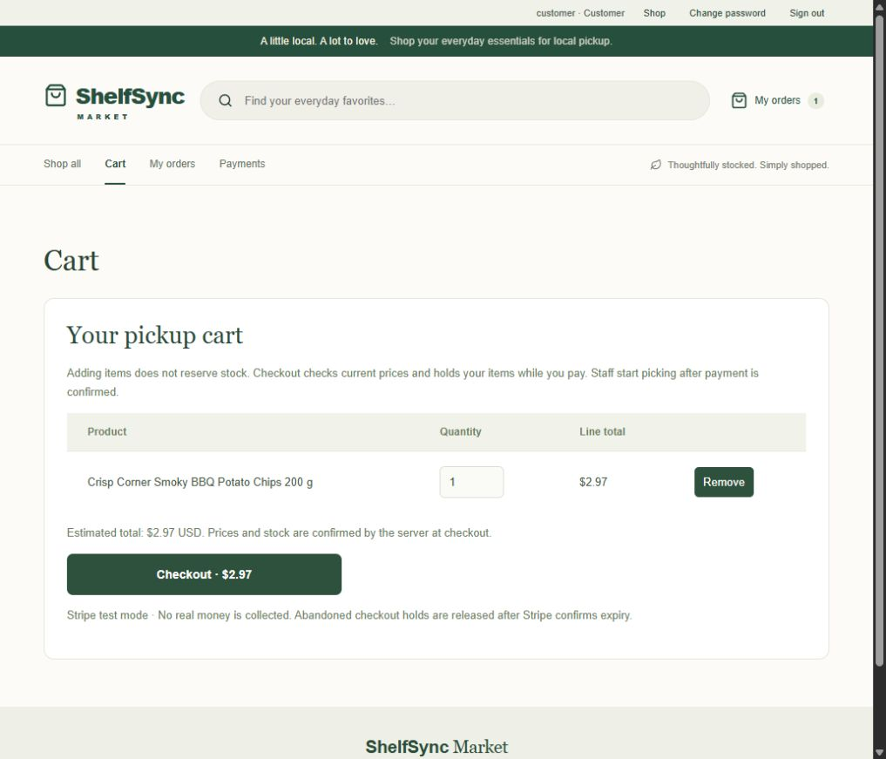
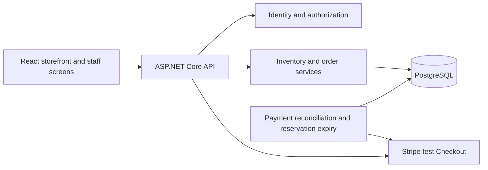

# ShelfSync

[](https://github.com/ShareefAldahhan/ShelfSync/actions/workflows/verify.yml)

**A store inventory and pickup-order application built with ASP.NET Core, React, TypeScript and PostgreSQL.**

Customers build a cart and pay through Stripe's test checkout. Store associates find the items, pick paid orders and complete pickup. Managers receive stock, correct counts and process returns. All of these operations share the same inventory, so the backend checks stock and records changes inside database transactions.

This project runs locally and uses fictional products. Stripe is in test mode, and email messages are displayed in an administrator preview inbox.

## Try the isolated demo

With Node.js 24, .NET 10 SDK and PostgreSQL 18 installed, run:

```powershell
node scripts/Demo.mjs
```

Open **http://127.0.0.1:5092**. The command builds the app and creates a fresh demo database, fictional products and Customer/Associate/Manager/Admin accounts. Payments are clearly labelled simulations, so no Stripe credentials are needed. The temporary demo accounts and setup details are in the [demo guide](docs/demo.md).

[Watch the app walkthrough (MP4)](docs/demo/app-walkthrough.mp4) - Customer cart, simulated payment, receipt, then Associate picking and pickup in the actual app.

## How an order works

1. A customer adds products to a cart. This does not reserve stock.
2. Checkout checks current stock and prices, then holds the items while the customer pays.
3. The backend verifies payment with Stripe. The customer can then view a receipt, and the order becomes available for picking.
4. An associate picks the order. The quantity moves from shelf stock to picked stock.
5. Completing pickup removes the quantity from picked stock and records the completed order.

An abandoned checkout releases its hold after Stripe confirms cancellation or expiry. If the payment result is uncertain, the hold stays in place until reconciliation resolves it. A browser redirect alone does not confirm payment.



## Accounts and store operations

| Role | Main actions |
|---|---|
| Customer | Browse products, manage a cart, complete test checkout, view their own orders and receipts |
| Associate | View barcode/bin/location information, receive and replenish stock, pick eligible customer orders, complete pickup and record simulated POS sales |
| Manager | Associate operations, inventory corrections, returns and shortage resolution |
| Admin | Account and role management, access audit, payment reconciliation and local email previews, plus store operations |

Public signup creates a Customer account. Only an Admin can assign staff roles. The configured `operator` login is the protected recovery Admin; its password is chosen privately during setup.

Product details show shelf/bin locations, stock quantities, sales history and recent inventory changes. Orders and inventory history support search and pagination. A keyboard-mode barcode scanner can be used for item lookup.


## Technical decisions

- **Stock changes use transactions and row locks.** Competing reservations and sales lock the relevant inventory before checking availability. Orders, stock movements, audit events and saved operation results commit together.
- **Retries reuse an operation identifier.** A repeated request can return its earlier result instead of changing stock again. Reusing an identifier with a different payload is rejected.
- **Payment state is separate from pickup state.** Payment confirmation is required before an associate can pick a customer's order. Stripe event signatures, server-owned amounts and provider reconciliation protect that boundary.
- **Permissions are enforced by the API.** Customer order ownership and staff roles are checked on the server, alongside cookie authentication, CSRF protection and login throttling.
- **Account and inventory queries share a bounded connection pool.** Load testing found that separate pools could exhaust PostgreSQL connections. The shared pool defaults to 80 connections, with explicit configuration supported.



The application is a single deployable API that also serves the compiled frontend. Database changes are applied by a schema owner; the application uses a restricted runtime login and never runs migrations automatically.

## Run locally

Requires **PowerShell 7, .NET 10 SDK, Node.js 24 and PostgreSQL 18**.

```powershell
git clone https://github.com/ShareefAldahhan/ShelfSync.git
cd ShelfSync
```

1. Follow [database setup](docs/setup.md) to create a dedicated database and restricted application login. Apply `database/schema.sql` only to a new database, followed by migrations `001` through `005` and their required grants.
2. Configure `ConnectionStrings:ShelfSync` privately through .NET user secrets or process configuration. Keep credentials out of source control.
3. Choose the recovery Admin password and build/start the app:

```powershell
pwsh -File scripts/Set-Operator.ps1
pwsh -File scripts/Start-Local.ps1 -Build
```

Open **http://localhost:5000**. Later starts use `pwsh -File scripts/Start-Local.ps1`. The backend serves the frontend, so a separate frontend server is unnecessary for the local release.

For test checkout, configure Stripe privately with `scripts/Set-Payments.ps1` and forward Stripe test events to `/api/payments/stripe-webhook`. See [payment setup](docs/payments.md). Checkout stays unavailable until its test settings are configured.

## Tests and release checks

```powershell
pwsh -File scripts/Verify-Release.ps1
```

The release gate creates its own password-protected PostgreSQL cluster and `shelfsync_test` database. It applies migrations twice, runs backend/frontend tests, exercises the published API and account permissions, checks production HTTP rejection, and restores a backup into another test database for comparison. The existing development database is not used.

The latest recorded local gate passed **143 backend tests and 4 frontend tests**, followed by **4 browser scenarios**, plus build, lint, published API and backup/restore checks. The badge above links to the current GitHub CI result; dated reports document earlier checkpoints.

To build a versioned package after the checks pass:

```powershell
pwsh -File scripts/Ship-Local.ps1
```

Packages under `artifacts/releases/` include the API, compiled frontend, migrations, setup documentation, file manifest and ZIP checksum. Credentials and database backups are excluded. See the [release guide](docs/local-release.md).

Browser checks can be reproduced with `node scripts/Demo.mjs --test` after installing Playwright Chromium. See the [demo and browser-test guide](docs/demo.md).

## Load-test results

A local benchmark sent **274,265 measured API requests with zero errors in the final run**.

| Workload | Concurrent workers | API calls/second | p95 response time |
|---|---:|---:|---:|
| Mixed browsing | 200 | 3,709 | 72 ms |
| Reserve/cancel across products | 200 | 2,754 | 103 ms |
| Reserve/cancel on one product | 100 | 459 | 271 ms |

The API, database and generator ran on one Windows PC, using 500 products and 5,000 initial orders. Workers shared one authenticated Admin session and sent requests without think time. At 200 workers, contention on a single product exceeded the 500 ms p95 target. These measurements describe this local test; they do not establish production shopper capacity.

[Full results and limitations](docs/benchmark-results-2026-10-25.md) · [Run the benchmark](docs/benchmarking.md)

## Documentation

| Guide | Contents |
|---|---|
| [Demo and browser tests](docs/demo.md) | One-command demo, simulated checkout, browser suite and recording |
| [Setup](docs/setup.md) | Prerequisites, database roles, configuration and troubleshooting |
| [Architecture](docs/architecture.md) | Components, transactions and stock rules |
| [API](docs/api-contract.md) | Routes, authorization and request formats |
| [Accounts](docs/accounts.md) | Roles, account administration and recovery |
| [Checkout](docs/checkout-first.md) | Stock holds, grouped payments, cancellation and expiry |
| [Payments](docs/payments.md) | Stripe test configuration and verification limits |
| [Store operations](docs/store-operations.md) | Receiving, replenishment, returns, scanning and receipts |
| [Release guide](docs/local-release.md) | Packaging, backup, restore and rollback |
| [Project and interview notes](docs/portfolio.md) | Resume bullets and a local demonstration guide |

## Current limits

Stripe supports test payments only. Email uses local previews. POS sales are simulated, and barcode lookup expects keyboard input from a scanner; phone-camera scanning is not implemented. The storefront catalog supports server-side search, department filters, sorting and pagination. The legacy product-list endpoint used by store checkout remains available.

A separate October 26 Stripe CLI check verified actual sandbox event delivery, signature validation, stored-event handling and authoritative USD 2.97 payment confirmation against an isolated database. See [verification evidence](docs/verification-2026-10-26.md). Full public hosting and real-money operation are outside the current local release.
