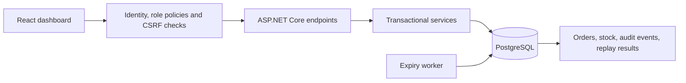

# ShelfSync

**Inventory reservations and order fulfillment with transactional stock protection.**

ShelfSync models one fictional store where online reservations and point-of-sale sales share shelf inventory. The application prevents software operations from claiming the same available units, handles reservation expiry, and records stock movements in an audit ledger.

Built with **ASP.NET Core 10 · PostgreSQL 18 · Npgsql · React · TypeScript · Vite**.


## For reviewers

Start with the [five-minute demo and resume project summary](docs/portfolio.md), then inspect the [measured load test](docs/benchmark-results-2026-10-25.md) and [release verification](docs/shipping-report-2026-10-25.md). The core engineering story is transactional inventory, retry-safe operations, payment reconciliation and a connection-pool issue found and fixed under load.

The $0 presentation is a static [portfolio showcase](showcase/index.html), with screenshots, an interactive workflow explanation and measured evidence. The full API/database remain locally runnable. See [free publishing](docs/free-portfolio.md).

## What works

- Click-through associate item pages with barcode, shelf location, stock buckets, sales history and inventory activity (requires the product-profile migration).
- Stripe-hosted full-cart test checkout before picking, owner-bound server totals, signed webhook confirmation and duplicate-payment protection (private Stripe setup required).
- Receiving, backroom-to-shelf replenishment, bounded returns, picked-order cancellation and low-stock views.
- Keyboard-mode barcode lookup, atomic multi-product pickup carts, printable receipts and searchable paginated inventory history.
- Administrator-only local email previews for order status and password recovery; no external email sending.
- Safe idempotent reservations; checkout holds stay protected until verified payment, cancellation or provider expiry. Legacy unpaid reservations retain their 15-minute lifetime.
- Operator shelf/bin location editing and audited shelf-count corrections with stale-count and reservation safeguards.
- Orders screen with search, state filters, cancellation, picking, shortage reporting/resolution and fulfillment.
- POS sales with event-based deduplication and stock validation.
- Row locks and atomic database transactions for inventory mutations and audit events.
- Background expiry processing and explicit lifecycle rules.
- Individual Customer, Associate, Manager and Admin accounts using ASP.NET Core Identity; customer order ownership, account administration, security audit, CSRF protection and session revocation.
- A combined dashboard/API release package, local startup scripts and CI configuration.

## Run locally

Requirements: **PowerShell 7, .NET 10 SDK, Node.js 24, PostgreSQL 18**.

First configure a development database and its connection as described in [setup](docs/setup.md). On the original development machine the database connection is already configured.

From the repository root:

```powershell
pwsh -File scripts/Set-Operator.ps1
pwsh -File scripts/Start-Local.ps1 -Build
```

Apply all additive migrations and account grants first (see [accounts and access](docs/accounts.md)). Choose your recovery administrator password when prompted, then open **http://localhost:5000**. Default username: `operator`. Later starts need only `pwsh -File scripts/Start-Local.ps1`. The backend serves the compiled dashboard; no separate frontend server is needed.

For frontend development, run the backend on localhost:5000 and `npm ci` followed by `npm run dev` inside `frontend/`. Open localhost:5173; Vite proxies the API.

## Verify the release

```powershell
pwsh -File scripts/Verify-Release.ps1
```

This builds the release and runs the suite against a separate temporary, password-protected PostgreSQL instance. It does not modify the existing PostgreSQL service, databases or permissions. The temporary instance stops afterward; ignored diagnostic files remain under `artifacts/`.

**Verified 25 October 2026:** 122 backend tests and 3 frontend tests passed, with published workflow/access/transport checks, migration replay, isolated backup/restore, build/lint and zero reported production dependency advisories. A versioned local package includes a file manifest and ZIP checksum. Source has local uncommitted changes, recorded in release metadata. Remote CI and Docker execution were not run locally.

## Engineering highlights



Reservations and POS sales serialize competing inventory changes using product inventory row locks. Successful stock/order/audit/replay writes commit together. A retried reservation uses the same operation key; a retried sale uses the same event ID. Reusing an identifier for a different payload is rejected.

Shelf units and picked units are separate stock stages. Reservations hold shelf availability logically; picking physically moves the recorded quantity from shelf to picked; fulfillment consumes picked stock. The backend remains authoritative even if the dashboard is stale.

## Package

```powershell
pwsh -File scripts/Publish.ps1 -Archive
```

Produces `artifacts/publish/`, `artifacts/publish.zip` and its SHA-256 checksum. The package includes build metadata, compiled API and dashboard. Configure database/operator secrets separately on the destination machine.

## Explore

| Document | Contents |
| --- | --- |
| [Checkout flow](docs/checkout-first.md) | Pay before picking, grouped cart payments and safe hold release |
| [Payments](docs/payments.md) | Stripe test setup, safeguards and payment limitations |
| [Store operations](docs/store-operations.md) | Receiving, returns, carts, scanning, receipts and local mail previews |
| [Accounts and access](docs/accounts.md) | Role matrix, account migration and recovery |
| [Setup](docs/setup.md) | Prerequisites, database roles, configuration and startup |
| [Architecture](docs/architecture.md) | Actual file map, request flow, stock rules and tradeoffs |
| [Associate item details](docs/associate-details.md) | Metadata migration, stock definitions and sales history |
| [API](docs/api-contract.md) | Implemented routes, authentication, payloads and errors |
| [Release guide](docs/local-release.md) | Verification evidence, packaging and operational limits |
| [Demo and portfolio notes](docs/portfolio.md) | Walkthrough, interview talking points and project description |
| [Acceptance checklist](docs/acceptance-scenarios.md) | Current release criteria and future extensions |
| [API benchmarking](docs/benchmarking.md) | Isolated load tests, throughput/latency reports, and connection budgets |

## Shipping a verified local release

Run `pwsh -File scripts/Ship-Local.ps1` to build, verify and package version 1.0.0 in a fresh `artifacts/releases/` directory. The package includes setup documentation, migrations, a manifest-verifying startup script and a ZIP checksum. See the [current release guide](docs/local-release.md).

## Scope and limits

ShelfSync is a local multi-role store application with fictional products. Customer, Associate, Manager and Admin accounts, customer-owned orders, stockroom/returns, paid-only picking, test-payment receipts and local email previews are implemented. Stripe is test-only; no real money or external email is sent. Orders and inventory history are paginated; the catalog currently returns all products.

POS sales are rejected when they would consume reserved stock. Inventory mutations recheck stock under database locks. Uncertain operations retain their retry identifiers in the same browser tab; closing it can lose those identifiers. Physical stock accuracy still depends on staff recording movements correctly.

Public hosting requires additional HTTPS/proxy, durable key storage, backup, monitoring, real-email and live-payment work. Local test and load-test evidence does not establish production-user capacity or an independent security certification. Historical checkpoints are preserved in [release history](docs/local-release-history.md); the current guide and source take precedence.
