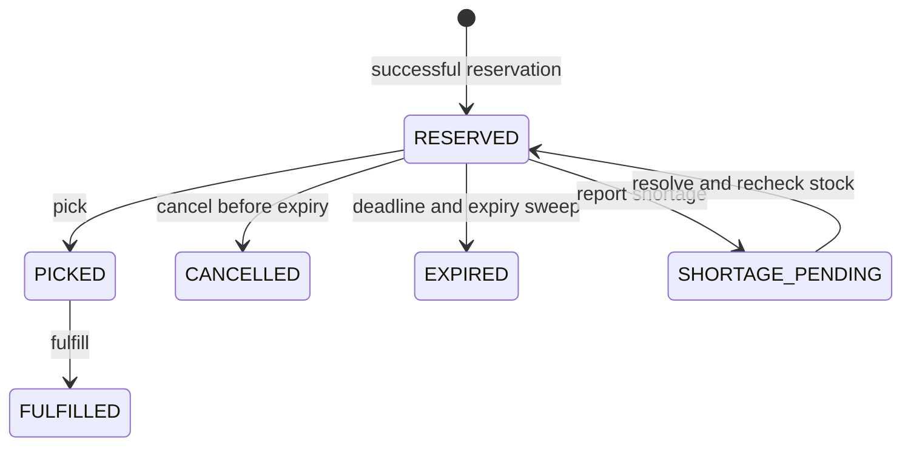

# Implemented architecture

## File map

| Location | Responsibility |
| --- | --- |
| frontend/src/App.tsx | Sign-in, sign-out and session-expiry interface |
| frontend/src/Dashboard.tsx | Catalog/orders reads, navigation, filters and summaries |
| frontend/src/ReservationControl.tsx | Reservation inputs, receipt and retry control |
| frontend/src/Workflows.tsx | Order lifecycle actions and POS form |
| frontend/src/session.ts | Session token retrieval and authenticated request wrapper |
| frontend/src/usePendingOperation.ts | Tab session storage for unresolved operation identifiers |
| backend/ShelfSync.Api/Program.cs | Dependency registration, HTTP routes, health and static frontend |
| backend/ShelfSync.Api/Security/OperatorSecurity.cs | Cookie authentication, operator access, CSRF and rate limiting |
| backend/ShelfSync.Api/Repositories/ | Product and recent-order read queries |
| backend/ShelfSync.Api/Services/ | Transactional business operations and expiry worker |
| backend/ShelfSync.Api/Models/ | Product, reservation and POS request/response records |
| database/schema.sql | Constraints, tables and indexes |
| tests/ShelfSync.Tests/ | Validation, stock/lifecycle, concurrency and replay tests |
| scripts/ | Operator setup, publishing, startup and release verification |

## Reservation request trace

```mermaid
sequenceDiagram
    participant U as Operator
    participant R as React
    participant A as API/security
    participant S as ReservationService
    participant D as PostgreSQL
    U->>R: Reserve product and quantity
    R->>R: Save UUID and payload for retry
    R->>A: POST, cookie, CSRF token, Idempotency-Key
    A->>S: Validated request
    S->>D: Begin transaction / claim operation key
    S->>D: Lock inventory; recheck current holds and stock
    S->>D: Create order, audit event, replay response
    S->>D: Commit
    S-->>R: 201 with order ID, state and expiry
    R->>R: Clear saved retry; refresh reads
```

Exact error/replay branches are implemented inside each service. Idempotency prevents duplicate writes when a success response is lost; it does not eliminate application or network failures. A different payload under the same identifier returns conflict.

## Stock and lifecycle



A reservation is a logical hold, not a physical shelf deduction. Picking subtracts shelf units and adds picked units. Fulfillment subtracts picked units. Cancellation releases a live RESERVED hold. POS subtracts shelf units only when its checks permit the sale without consuming reserved stock.

The database schema forbids negative shelf/picked stock. Services use transactions and inventory locks, then re-evaluate state and time before committing changes. Mutations record inventory events together with their state changes. Reservation expiry runs periodically; expired holds do not remain valid simply because the worker has not swept them yet.

RESTOCK_PENDING exists in the schema but has no implemented transition route. Do not infer support from a state name alone.

## Security and boundaries

The single Operator role can access all business operations. Health endpoints are anonymous. Cookies are signed, HttpOnly and SameSite Strict; mutating requests require antiforgery tokens. Operator credentials are hashed. A credential fingerprint in signed sessions is checked against current configuration. Production API requests require HTTPS. Deployment-specific trusted proxies and durable key storage must be configured separately.

The UI is an operational client; hiding an action is not authorization. The backend checks every operation. Direct database writes outside these services can violate application-level allocation invariants even when simple table constraints still pass.

## Chosen tradeoffs

Direct Npgsql SQL keeps locks and transaction boundaries visible. One store and single-item orders keep the concurrency problem focused. The latest-100 read model keeps the UI simple; pagination is future work. HTTP refresh after mutations avoids WebSocket infrastructure. The local single-operator model avoids inventing customer ownership rules.

Conservative POS validation is appropriate for this simulated software-controlled sale flow. It does not reconcile real external till events that have already happened. Backroom allocation, external-feed outages, physical discrepancies, receiving and restocking require separate policies before implementation.
