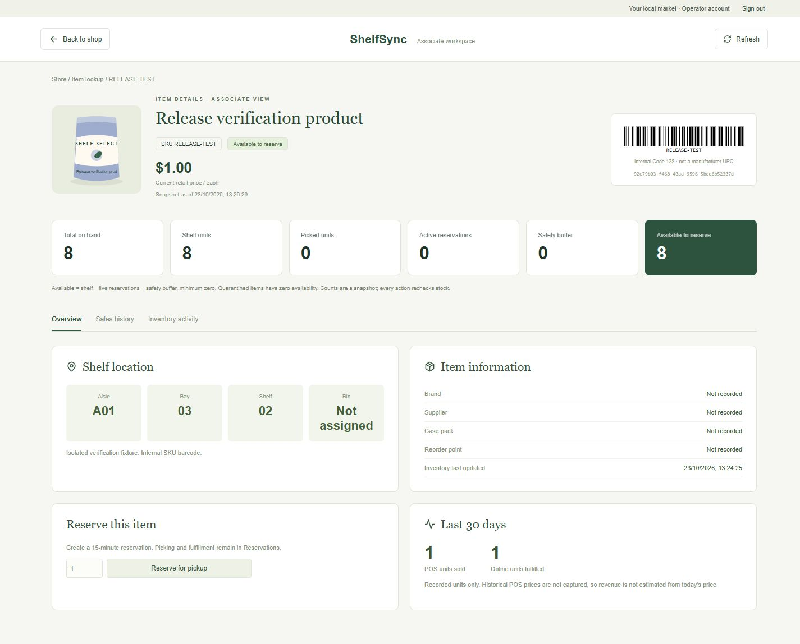
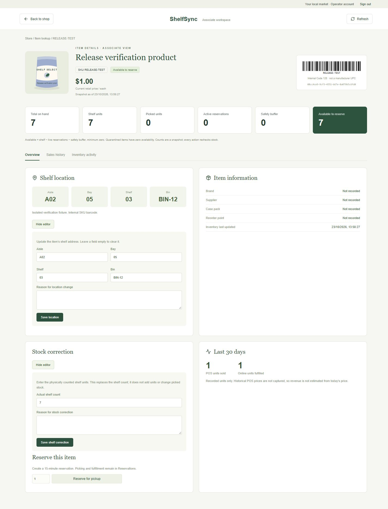

# Associate item details

Click a product image or title in the storefront to open `#product/<uuid>`. Links survive browser reloads and support browser back/forward. The associate view requires Associate, Manager or Admin. Customers receive a simpler product/reservation page. Shelf corrections require Manager or Admin; location edits permit all staff.

The page shows a scannable internal Code 128 barcode, SKU and product ID; current retail price; aisle/bay/shelf/bin; total on-hand, shelf, picked, active reserved, safety buffer and available quantities; quarantine status/reason; last inventory update and snapshot time; case pack, supplier, brand and reorder threshold when recorded; a reservation action; POS sales history; and the inventory/order activity ledger.

## Data integrity

`GET /api/products/{id}/details` uses a repeatable-read database transaction so quantities and history come from a consistent snapshot. Live reserved units count only RESERVED orders whose expiry is later than the snapshot time. Available units are `max(0, shelf - liveReserved - safetyBuffer)`, or zero when quarantined. Picked stock is already off the shelf and is not subtracted twice.

Sales history is the latest 100 committed POS events, not fabricated chart data. The 30-day POS unit total is calculated over all matching events, independently of that 100-row display cap. Online fulfilled units are counted separately from FULFILL ledger events. Inventory activity is the latest 100 events. Historical POS prices are not stored, so the page does not calculate revenue using today's price. Unknown products return 404.

Missing operational fields display as Not recorded/Not assigned. Existing SS demo products receive fictional locations and their own SKU as an internal barcode; no manufacturer UPC or real store location is invented. Other products use SKU barcode fallback until their profile is configured. Barcode rendering uses [JsBarcode](https://github.com/lindell/JsBarcode).

## Database upgrade

Apply `database/migrations/001_product_profiles.sql` after `database/schema.sql`. The additive migration creates product_profiles and a POS history index; it does not alter stock quantities or orders. SS demo locations are inserted only where a profile does not already exist. Fresh verification databases and CI apply migrations automatically in filename order.

On an existing local development database, a schema administrator must apply it and grant the existing application role SELECT on product_profiles. The runtime app account deliberately lacks the required schema/reference privileges. Do not grant it administrator privileges.

`scripts/Apply-Migrations.ps1` prepares this upgrade for the named local shelfsync_dev or shelfsync_test database, prompts privately for the PostgreSQL administrator password, applies migrations and grants only SELECT on the new profile table. It must be run only after user approval of the database/access change. No administrator password is stored by the script. Existing development data is preserved.

The upgrade is not applied automatically at API startup. Publish the updated API and restart it after the migration; copying a new frontend alone cannot activate a new backend endpoint. The implementation is published in artifacts/publish and enabled on localhost:5000 after the approved migration.

## Verification

Four additional integration tests cover unknown products, metadata, expired-hold exclusion, safety buffer and quarantine, missing-profile fallback, replay-safe product-scoped POS history, 30-day filtering and fulfilled unit/activity totals. The suite now contains 46 tests. Published HTTP checks also assert the details endpoint's quantities, history and 404 handling.

Run `pwsh -File scripts/Verify-Release.ps1` with the current published package, or `-SkipPublish -PublishDirectory artifacts/item-preview` for the independently built preview. An optional `-Preview` starts a temporary loopback browser demo after verification using only the isolated test database. Stop it with Ctrl+C; its temporary credentials do not change saved operator credentials.

## Verified preview — 23 October 2026

All 46 integration tests passed in the isolated cluster. Published HTTP checks confirmed barcode/history data, available stock, replay-safe POS and online fulfillment totals and unknown-item 404 responses. Browser checks covered clicking through from a product, the overview/barcode/location display, sales and activity tabs, back navigation, and mobile page width; no captured console errors. The saved screenshot uses a clearly identified isolated test product, not fabricated production history.

After explicit user approval, the administrator migration was completed on the local development database. The app account can read all 12 demo profiles. The tested backend/frontend were activated and the app restarted; readiness and authenticated product-details/barcode/security checks passed. Existing stock and orders were preserved.

## Operator editing — 23 October 2026

On Overview, choose **Edit shelf / bin location** to set aisle, bay, shelf and bin (40 characters maximum per field; blank clears a field). Choose **Correct shelf quantity** to enter the physically counted shelf units as an absolute nonnegative count, up to 1,000,000. Both require a reason of 3–500 characters.

Stock corrections acquire the same product inventory lock as reservations/POS. A submitted expected shelf count must match the current count; otherwise the request returns 409 and the operator must refresh/recount. A correction below live reserved units returns 409: report shortages for affected orders first. Picked quantities, safety buffer and quarantine are not silently changed. Location updates also use the inventory lock to serialize audit snapshots.

Each successful update commits a RECONCILE ledger event with actor, reason, operation type, request key and before/after values. Stock corrections record the actual shelf delta; location changes use zero stock delta. The activity table displays reason and operator. UUID request keys and tab-session retry storage prevent uncertain retries from creating duplicate corrections/audit events. Reusing a key with changed values conflicts. Failed validation/conflict operations roll back their request claim and stock writes.

Routes: `POST /api/products/{id}/location` with `{aisle,bay,shelf,bin,reason}`; `POST /api/products/{id}/stock-correction` with `{shelfUnits,expectedShelfUnits,reason}`. Both require Operator session, CSRF token and Idempotency-Key. Profile editing requires INSERT/UPDATE on product_profiles, approved and applied locally through `Apply-Migrations.ps1 -EnableProfileEditing`. No additional tables/columns were needed.

All **53 integration tests passed**, including new invalid-count/reason, replay/conflict, stale-count, reserved-stock floor, location add/change/clear and POS/correction concurrency cases. Published HTTP checks verified authenticated edits/replay/audit on an isolated fixture. Browser checks saved a new test bin and corrected a test count, verified the result and audit actor/reason, and captured no console errors. No development stock or location values were changed by those tests. The tested build was activated on localhost and database readiness/read/security checks passed.

