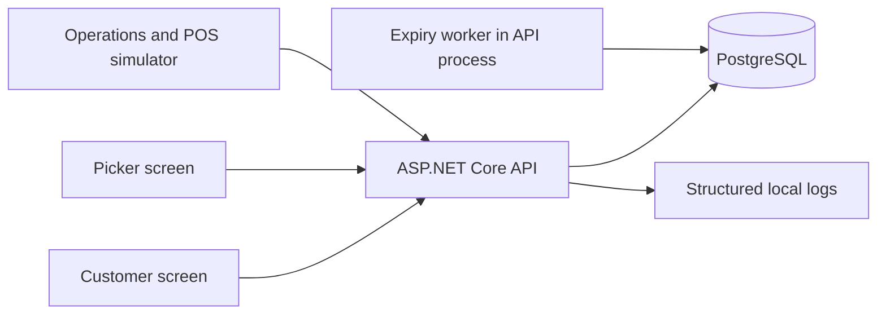
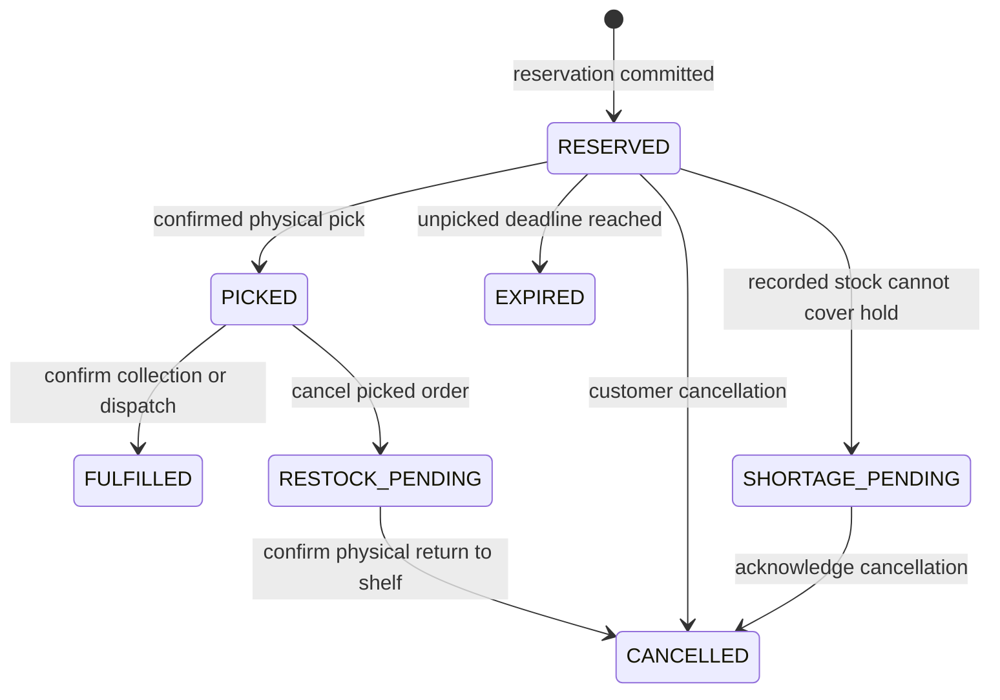

> Historical planning/learning document. Some proposals differ from the completed local MVP. See [current architecture](architecture.md), [API contract](api-contract.md), and [release guide](local-release.md) for implemented behavior and verification.

# Software design and safe failures

## Architecture

One local application, one store, one database. Poll order/inventory endpoints after actions rather than adding sockets. All stock mutations go through the same inventory transaction service. The database is authoritative; UI counters are never proof of fulfillment.

## Stock definitions

- `shelf_units`: recorded stock accessible to in-store shoppers, including unpicked reserved units. Can be negative after a reported external sale; negative is an inventory discrepancy, not a sellable quantity.
- Active reservation: an order in `RESERVED`, with `expires_at > database current time`. Includes unpicked units only.
- `picked_units`: stock physically separated for online fulfillment; cancellation does not automatically return it to shelf.
- `safety_buffer`: configurable units withheld from new online reservations. Default zero for the three-bag demonstration; show that this is an assumption.
- Available to promise: if healthy, `max(0, shelf_units - active reservation units - safety_buffer)`; otherwise zero.
- Healthy: SKU not quarantined, shelf count nonnegative, and POS feed heartbeat within 60 seconds (demo threshold).

Picked units are already removed from `shelf_units`, so do not subtract them again. Total recorded store stock is shelf plus picked; dispatched stock is no longer in either bucket. Counts must specify shelf-only inventory, excluding fulfillment stock.

The feed heartbeat is a demo signal of freshness, not evidence that real retail events are complete. The simulator generates it automatically while running; operations can pause it for a failure exercise. Heartbeat resumes do not clear SKU quarantine.

## Order state machine

Shortage recovery in week one is cancellation and count reconciliation. Substitution/reallocation is later scope. An order initially confirmed is confirmed as reserved, not guaranteed fulfilled. A missing pick transitions to shortage and flags stock for reconciliation; it never invents a count from a single failed search.

TTL defaults to 15 minutes for unpicked demo reservations. Only `RESERVED` orders expire. `PICKED`, `RESTOCK_PENDING`, and `SHORTAGE_PENDING` never release stock through the timer. Production picking deadlines are a separate policy.

## Transaction and concurrency rules

Use PostgreSQL Read Committed with a per-SKU `SELECT ... FOR UPDATE` row lock. Every inventory writer locks the same inventory row before reading/changing reservation or movement state. Lock ordering: request-key claim first, then inventory, then affected orders. Avoid holding locks while performing network calls. SQL parameters are mandatory.

Reservation algorithm:

1. Claim a client-generated idempotency key scoped to operation; store a hash of canonical semantic inputs. Same key/different inputs returns conflict. Concurrent identical requests resolve to one persisted result, with a bounded wait.
2. Begin a transaction and lock inventory. Load/lock relevant order state only after inventory.
3. After acquiring the lock, capture `clock_timestamp()` as the decision time and lazily mark overdue unpicked reservations expired. PostgreSQL `CURRENT_TIMESTAMP` is transaction-start time and may be stale after waiting for a lock; do not use it for this deadline check. Recalculate reservation totals from orders; do not maintain a separate mutable reservation counter.
4. Check freshness/quarantine and available units. Reject if unhealthy or insufficient. Positive integer quantity is required.
5. Create order and ledger event, save request result, commit atomically.
6. Return the persisted result. If response delivery fails, client repeats the same key or looks up the original request; never automatically generates a new key.

Implementation may claim the request-key row inside the same transaction with a unique constraint. If it loses a unique-key race, roll back the failed transaction before reading the winner's result. Do not continue SQL in a failed transaction. Deterministic business rejections can be stored for replay; transient failures roll back without a success result.

POS event algorithm:

- External `event_id` is unique, with payload hash. A repeated identical event returns the original result; conflicting payload returns 409 and an investigation signal.
- Deduplication, stock movement, ledger entry, and shortage decisions commit together.
- A reported actual sale deducts shelf stock even if it consumes unpicked reservations. Do not reject a genuine recorded sale merely to preserve online promises.
- Where remaining shelf stock cannot cover active reservations, keep earlier reservations first and move newest reservations to `SHORTAGE_PENDING` until retained reservations fit. Single-item quantities are all-or-nothing. Record the policy and affected orders.
- Quarantine the SKU after any shortage or negative shelf count; accept subsequent observed inventory events, but reject new online reservations until an explicit reconciliation.
- Physical shoppers using picked stock are outside the model. A separately reported picked-area discrepancy must be handled explicitly, not as an ordinary shelf checkout.

Pick locks inventory, checks order state and deadline using a decision time captured with `clock_timestamp()` after lock acquisition, and requires confirmed quantity and sufficient shelf units. Then move quantity shelf -> picked, set `PICKED`, and write the event together. Quarantine or stale feed requires manual reconciliation before normal pick confirmation; reporting a missing item remains allowed. Reads return both persisted state and effective state if expiration cleanup has not yet occurred.

Cancel of `RESERVED` releases only its logical hold. Cancel of `PICKED` becomes `RESTOCK_PENDING` and leaves quantities unchanged. Confirmed physical restock moves picked -> shelf and cancels the order. Fulfill moves units out of picked and completes the order. Repeated transitions cannot move stock twice.

Shelf reconciliation locks inventory and related orders, validates a nonnegative observed shelf count, records the difference as a movement with a reason, resolves any remaining uncovered reservations, and clears quarantine only if shelf stock covers surviving holds. Fresh feed status is independently required for new reservations.

## Safe failure policy

| Failure | Backend behavior | Customer/operator behavior | Recovery |
| --- | --- | --- | --- |
| Stale product display | Recheck inside locked transaction | Explain that availability changed | Refresh; submit a new intentional request |
| Final-unit race | Only one transaction reserves | Losing request sees insufficient stock | No partial order or leaked hold |
| Database unreachable | Reject new stock mutations; no success claim | Inventory unavailable; do not show zero as a verified count | Retry same operation/key after recovery |
| Failure before commit | Roll back order, stock, ledger, and request result | Request failed or outcome unknown according to what client observed | Retry same key |
| Commit succeeds but response is lost | Committed result remains durable | "Checking order status"; confirmation stays disabled | Retry same key or request lookup |
| Duplicate checkout event | Return saved event result | No second deduction | No corrective adjustment needed |
| Same event ID with different quantity | Reject conflicting replay | Operator sees conflict | Correct through a new explicit event |
| POS feed stale | Available-to-promise zero; reject new holds | "Online ordering temporarily paused" | Restore/replay feed; reconcile discrepancies |
| Shelf shortage | Mark affected orders, quarantine SKU | "Item unavailable; action required" | Cancel affected order; perform count reconciliation |
| Negative recorded shelf count | Preserve signed discrepancy; zero availability | Show needs-reconciliation status | Count and documented adjustment |
| Expiry worker stops | Time-based queries exclude expired holds; restart sweep resumes | Past-deadline orders cannot be picked | Lazy expiry and worker sweep |
| Pick competes with expiry | Shared lock plus deadline predicate selects one valid outcome | Display persisted order status | No contradictory success or double release |
| Cancel after pick | Keep physical picked stock reserved | "Awaiting physical return" | Confirm restock before releasing stock |
| Lock timeout/deadlock | Abort transaction; bounded retry with same key | Temporarily busy, no success | Retry twice with jitter; then surface 503 |
| Repeated fulfill/restock | Validate terminal state and replay result | Show existing outcome | No duplicate physical movement |

Do not acknowledge an event before its transaction commits. The simulator is not an actual offline checkout: if submission fails, it retains the pending command and retries the same event ID. A production POS needs its own durable event log and replay mechanism; browser memory is not durable. Never claim the demo guarantees inventory during disconnected real-world sales.

## Screen designs

### Customer

Product cards: name, price, available-to-order quantity, availability status, quantity input, Reserve button. After reservation: order reference, state, server expiry time, cancel action. Errors give a concrete next action. On an ambiguous response show a checking state with retry/status controls, not a second purchase button.

### Picker

Queue: order ID, item, quantity, deadline, state. Actions: Confirm physically picked, Report missing, Confirm dispatch/collection. Every action waits for server confirmation and displays the persisted state. Separate restock queue for canceled picked items.

### Operations

Inventory table: SKU, shelf, active reserved, picked, buffer, available, quarantine, feed age. Checkout simulator accepts event ID and quantity. Reconciliation form requires count and reason. Event history explains movements. Development-only failure controls pause heartbeat or trigger faults before commit/after commit.

Failure controls must be disabled outside Development and never enabled through an unrestricted production query parameter. No sensitive data in logs; use request/order/event references.

## Technical references

- PostgreSQL row locking: https://www.postgresql.org/docs/18/explicit-locking.html
- .NET support policy: https://dotnet.microsoft.com/en-us/platform/support/policy

These references support implementation mechanics, not the fictional store's business policies.
